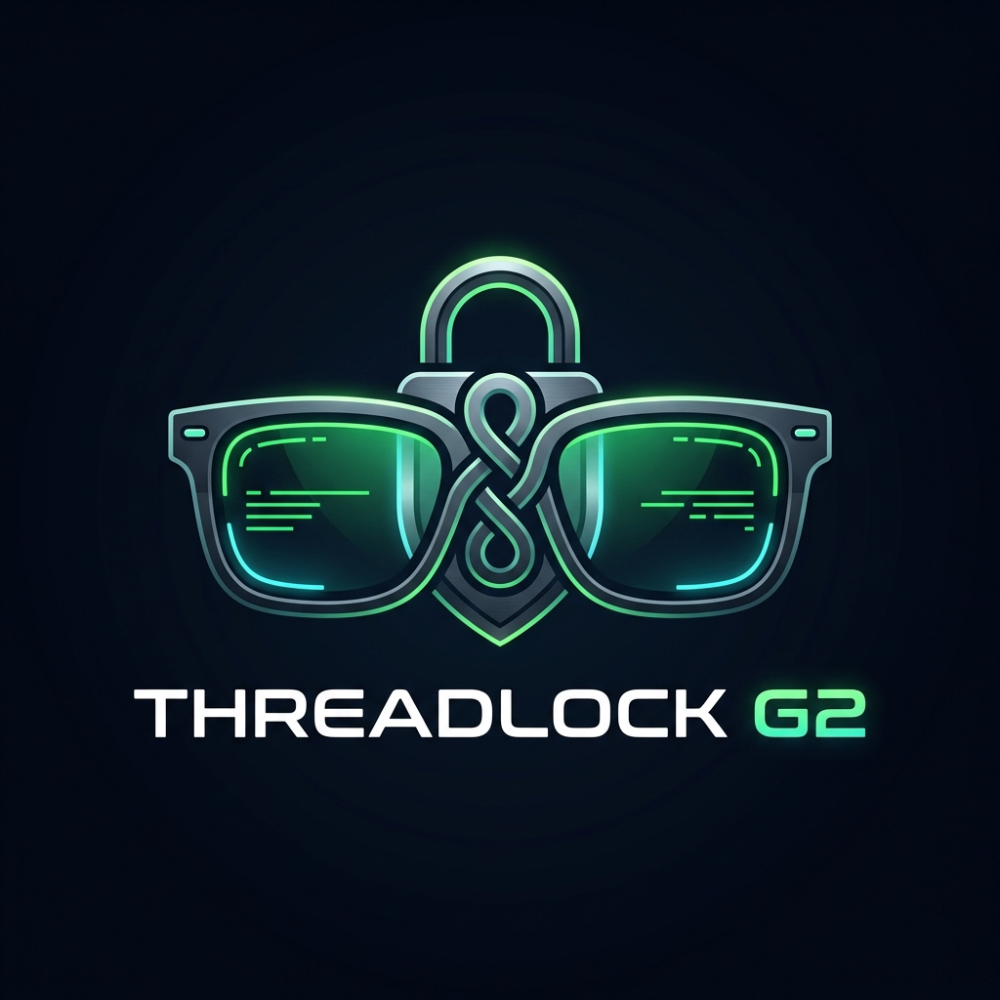
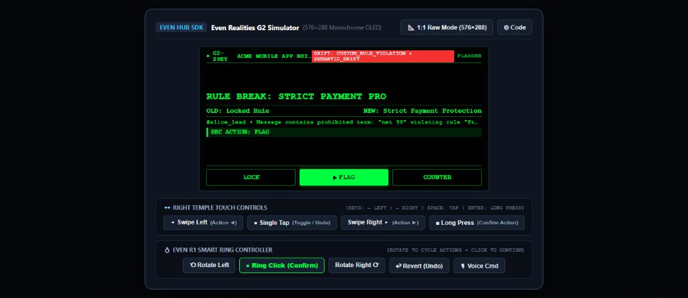
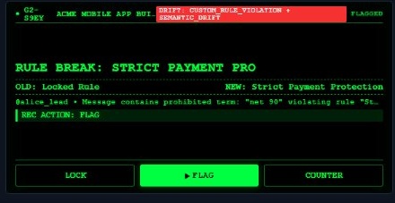
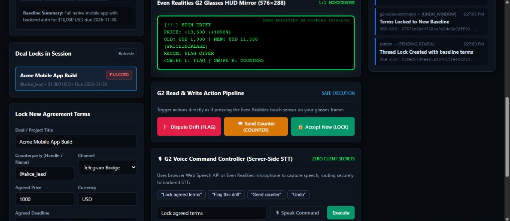
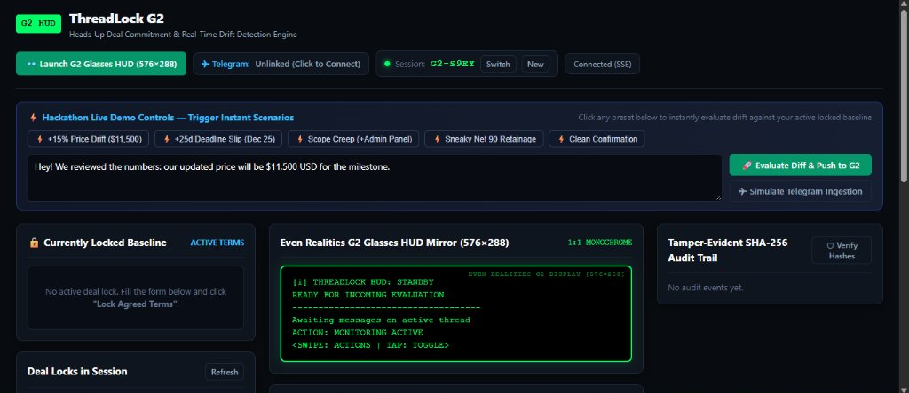
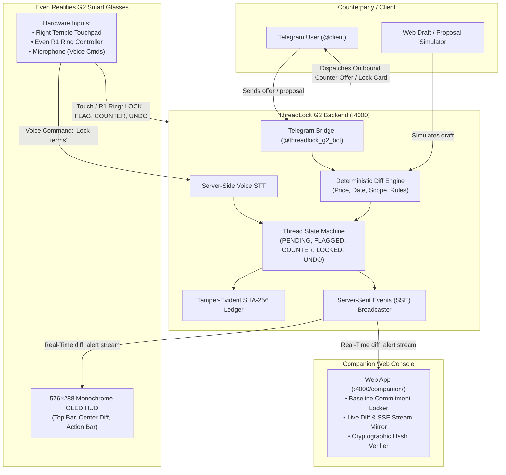

<p align="center">
  
</p>

<h1 align="center">ThreadLock G2 🕶️🔒</h1>
<p align="center">
  <strong>Heads-Up Deal Commitment & Terms Drift Detection HUD for Even Realities G2 Smart Glasses</strong><br>
  <em>Built for the "Heads Up: Even Realities Hackathon" (Deadline: Nov 30, 2026)</em>
</p>

<p align="center">
  <a href="backend/tests/"></a>
  <a href="g2-app/app.json"></a>
  <a href="g2-app/evenhub-adapter.js"></a>
  <a href="https://t.me/threadlock_g2_bot"></a>
  <a href="LICENSE"></a>
</p>

---

## 🚀 Live Cloud Demo (24/7 Available for Judges)
- **Live Companion Web Console**: [https://threadlock-g-a74c8.containers.snapdeploy.app/companion/](https://threadlock-g-a74c8.containers.snapdeploy.app/companion/)
- **Live Even Realities G2 HUD (Interactive)**: [https://threadlock-g-a74c8.containers.snapdeploy.app/g2/](https://threadlock-g-a74c8.containers.snapdeploy.app/g2/)
- **Live G2 Viewport (1:1 Raw 576×288 Mode)**: [https://threadlock-g-a74c8.containers.snapdeploy.app/g2/?mode=raw](https://threadlock-g-a74c8.containers.snapdeploy.app/g2/?mode=raw)
- **Official Telegram Bot**: [@threadlock_g2_bot](https://t.me/threadlock_g2_bot) (Session Pairing: `G2-S9EY` or [1-Click Link](https://t.me/threadlock_g2_bot?start=G2-S9EY))

---

## 📸 Visual Showcase & Hardware Demonstration

### 1. Even Realities G2 Heads-Up Display (576×288 Monochrome OLED)
Optical see-through display showing real-time deal drift, custom rule alerts, and active touch-temple / Even R1 ring action controls in pure green phosphor (`#00FF41`).



> **G2 HUD Optical Close-Up (1:1 576×288 Micro-OLED View)**:
>
> 
>
> *Above: Real-time custom rule violation caught on incoming contract draft. Notice the active `▶ FLAG` action highlighted in bright phosphor, ready for 1-tap temple touch confirmation.*

<p align="center">
  <a href="https://threadlock-g-a74c8.containers.snapdeploy.app/g2/">
    
  </a>
  <a href="https://threadlock-g-a74c8.containers.snapdeploy.app/g2/?mode=raw">
    
  </a>
</p>

---

### 2. Companion Web Console — Active Negotiation Drift Evaluation
The desktop/tablet command console where agreed baselines are locked, live Telegram threads are paired, and cryptographic SHA-256 audit logs are verified.



*Key Features shown above:*
- **Real-Time High Drift Alert**: Immediate detection of `+1050%` price surge (`$1,000` ➔ `$11,500 USD`) from client proposal.
- **Simultaneous G2 Mirror**: Live SVG/OLED mirror displaying exact optical glasses rendering in sync.
- **Read & Write Action Pipeline**: Instant one-click triggers for `Dispute Drift (FLAG)`, `Send Counter`, and `Accept New (LOCK)`.
- **Server-Side Voice STT**: Speech recognition interface routing commands to backend with zero client secrets.
- **Tamper-Evident SHA-256 Ledger**: Every state transition cryptographically hashed with live audit trail verification.

<p align="center">
  <a href="https://threadlock-g-a74c8.containers.snapdeploy.app/companion/">
    
  </a>
</p>

---

### 3. Live Demo Controls & Instant Scenario Testing
Pre-configured judge test cases to immediately test price drift, deadline slips, scope creep, and payment clause violations.



*1-Click Preset Chips for Judges:*
- **+15% Price Drift**: Evaluates `$11,500` against `$10,000` baseline.
- **+25d Deadline Slip**: Detects unapproved delivery push to Dec 25.
- **Scope Creep**: Flags unauthorized deliverable addition (*"Can you throw in an admin panel?"*).
- **Sneaky Net 90 Retainage**: Flags payment terms violating strict cash flow rules.
- **Clean Confirmation**: Verifies flawless agreement match.

<p align="center">
  <a href="https://threadlock-g-a74c8.containers.snapdeploy.app/companion/">
    
  </a>
</p>

---

## 🎯 The Problem & Vision

In freelance contracts, high-stakes sales, consulting, and partnership negotiations, agreements are forged across messaging apps (Telegram, Slack, Email). However, commitments frequently **drift**:
- **Sneaky Price Shifts**: Proposals subtly altering figures (`+$1,500` or currency swaps from USD to EUR).
- **Scope Creep**: Added deliverables slipped into casual chat (*"Can you also throw in an admin panel and tablet support?"*).
- **Deadline Slips**: Key milestones pushed back (*"Due to holidays, let's push final delivery back by three weeks"*).
- **Delayed Payment Clauses**: Problematic vendor payment clauses slipped into drafts (*"Payment on Net 90 with 20% retainage held"*).

Looking down at a laptop or opening dense spreadsheets during a face-to-face meeting or call breaks eye contact and destroys negotiation leverage.

**ThreadLock G2** runs directly in your **Even Realities G2 smart glasses heads-up display**. You lock agreed baseline terms once on your Companion Web app. As incoming messages, offers, or contract drafts arrive (via our live Telegram bot or companion simulator), the **Backend Diff Engine** evaluates drift deterministically and semantically in under 200ms, flashing an instant, high-contrast monochrome glance card (`576×288`) onto your glasses HUD with immediate touch-temple or Even R1 Ring shortcuts to **Flag**, **Counter**, or **Lock**.

---

## 🌟 Why ThreadLock G2 Stands Out on Even Realities G2

| Traditional Smartwatch / Phone | Even Realities G2 with ThreadLock G2 |
|---|---|
| Breaks eye contact to check phone screen | **Natural Eye Contact**: 576×288 optical see-through HUD displays drift floating transparently in peripheral vision |
| Passive notifications (just alerts you) | **Active Read & Write Action Engine**: Flag, Counter, or Lock terms directly via temple touch gestures or Even R1 Ring |
| Cluttered multi-column tables unreadable on micro displays | **Glance-First Information Architecture**: Strictly formatted 5-line glance cards readable in 1 second |
| Accidental button presses trigger irreversible commitments | **30-Second Safe Undo Window**: Live countdown banner on HUD allows instant 1-tap rollback |
| Cloud-dependent secrets exposed in client WebViews | **Zero-Client-Secrets Architecture**: External calls, STT, and bot tokens routed strictly through backend |

---

## 🏗️ System Architecture



---

## 🕶️ Even Realities G2 Hardware Constraints & Engineering

Even Realities G2 smart glasses feature an optical see-through display with strict physical constraints:
- **Display**: Monochrome green phosphor (`#00FF41`), `576 × 288` pixels per eye, pure `#000000` black background (OLED pixels fully powered off).
- **Sensors & Inputs**:
  - Right temple capacitive touch bar (Swipe Left/Right, Tap, Double Tap, Long Press).
  - Even R1 Smart Ring controller (Rotary dial CW/CCW, tactile click).
  - Dual micro-beamforming microphones (voice command capture).
  - **No camera or speaker** (privacy-first, silent operation).
- **Even Hub SDK Lifecycle Compliance**: WebView listens to visibility changes (`lifecycle`), automatically suspending background SSE polling when the user switches away to conserve battery and eliminate unwanted background popups.

---

## 🎛️ Monorepo Structure

```
Threadlock-G2/
├── backend/                       # Node.js/TypeScript Core Backend Engine
│   ├── src/
│   │   ├── diff-engine/           # Deterministic & Semantic Drift Evaluator
│   │   │   ├── currency-parser.ts # Parses $10k, €5000, 15k USD, percentages
│   │   │   ├── deadline-parser.ts # Parses ISO dates, relative shifts ("in 2 weeks")
│   │   │   ├── scope-comparator.ts# Token-set similarity, creep & cuts detection
│   │   │   ├── rules-engine.ts    # Custom constraints & forbidden terms engine
│   │   │   ├── semantic-detector.ts # Heuristic + optional LLM semantic analysis
│   │   │   ├── glance-formatter.ts# Strict 576×288 Even Realities HUD formatter
│   │   │   └── index.ts           # DiffEngine main pipeline
│   │   ├── state-machine/         # PENDING_REVIEW, LOCKED_NEW, FLAGGED, COUNTER_SENT, UNDO_WINDOW
│   │   ├── audit/                 # Tamper-evident SHA-256 hash-chained ledger
│   │   ├── pairing/               # 6-char session codes & strict data isolation
│   │   ├── stream/                # Server-Sent Events (SSE) real-time HUD broadcaster
│   │   ├── telegram/              # Telegram Bot API client & bridge with TLS resilience
│   │   │   ├── telegram-client.ts # Universal transport (fetch + system curl fallback)
│   │   │   └── telegram-bridge.ts # Long-polling, webhook & command parser
│   │   ├── actions/               # Read & write action executor & counter generator
│   │   ├── voice/                 # Server-side STT & intent classifier
│   │   └── server.ts              # Express REST + SSE API & static app host
│   └── tests/                     # 7 suites, 45 automated unit & integration tests
├── companion-web/                 # Responsive Companion Web Application
│   ├── index.html                 # Commitment locker, demo bar, audit viewer
│   ├── styles.css                 # Cyberpunk/fintech dark mode responsive styling
│   └── app.js                     # SSE client, Web Speech API mic, state controller
├── g2-app/                        # Even Hub SDK WebView Application
│   ├── app.json                   # Even Hub manifest descriptor (576×288 monochrome)
│   ├── evenhub-adapter.js         # Unified hardware adapter for G2 & R1 Ring
│   ├── styles.css                 # 576×288 high-contrast monochrome OLED styling
│   ├── app.js                     # G2 HUD controller & gesture handler
│   └── index.html                 # Strict 576×288 HUD + Temple & Ring simulator
├── DEMO_SCRIPT.md                 # 3-minute hackathon video demo walkthrough
├── app.json                       # Root Even Hub application configuration
├── .env.example                   # Environment configuration template (zero secrets)
└── package.json                   # Monorepo root scripts & workspaces
```

---

## ⚡ Quick Start & Run Commands

### 1. Requirements
- Node.js `v20+` or `v24+` (tested on `v24.17.0`)
- npm `v10+` or `v11+`
- Git

### 2. Installation
```bash
# Clone the repository
git clone https://github.com/developer-yasir/Threadlock-G2.git
cd Threadlock-G2

# Install dependencies
npm --prefix backend install
```

### 3. Run Automated Tests
```bash
npm test
```
*Executes all 45 automated unit, integration, and Telegram tests across 7 test suites (100% green).*

### 4. Start the Server
```bash
npm start
```

### 5. Access the Interfaces
- **Landing Hub**: [http://localhost:4000/](http://localhost:4000/)
- **Companion Web Console**: [http://localhost:4000/companion/](http://localhost:4000/companion/)
- **Even Realities G2 Simulator (Interactive Harness)**: [http://localhost:4000/g2/](http://localhost:4000/g2/)
- **G2 Glasses Viewport (1:1 Raw 576×288 Mode)**: [http://localhost:4000/g2/?mode=raw](http://localhost:4000/g2/?mode=raw)

---

## ✈️ Live Telegram Bot Integration

ThreadLock G2 includes a real, active Telegram bot bridge:
1. In Telegram, open [@threadlock_g2_bot](https://t.me/threadlock_g2_bot).
2. Link your session by sending:
   ```text
   /link G2-S9EY
   ```
   *(Or click the 1-click deep link: `https://t.me/threadlock_g2_bot?start=G2-S9EY`)*
3. Send any offer or proposal in the chat:
   ```text
   We reviewed the quote: total price is now $13,500 USD and delivery pushed to Dec 25.
   ```
4. Watch the G2 HUD and Companion Web alert simultaneously! Reply with `/counter`, `/flag`, `/lock`, or `/undo` directly in Telegram.

---

## 🔑 Environment Variables (`.env.example`)

Copy `.env.example` to `backend/.env` (and root `.env`):
```ini
# Server Configuration
PORT=4000
HOST=0.0.0.0
NODE_ENV=development

# Real-Time SSE Stream Configuration
STREAM_HEARTBEAT_MS=15000

# Telegram Bridge Configuration
TELEGRAM_BOT_TOKEN=your_token_here
TELEGRAM_BOT_USERNAME=@your_bot_username
TELEGRAM_POLLING=true

# Security & State
DEFAULT_UNDO_WINDOW_SECONDS=30
AUDIT_LOG_SALT=threadlock-g2-salt-change-in-prod
PAIRING_CODE_EXPIRY_MINUTES=60
```

---

## 📋 Open-Source & Pre-Existing Code Disclosures
*(Mandatory Disclosure for Even Realities Hackathon 2026)*

### Pre-Existing Open-Source Libraries (Pre-Nov 23, 2026):
- **Runtime & Language**: Node.js v24, TypeScript v5.7.
- **Backend Infrastructure**: `express` (HTTP routing), `cors` (cross-origin resource sharing), `dotenv` (environment configuration).
- **Testing Framework**: `vitest` (test runner), `supertest` (HTTP assertions).
- **Core Node Modules**: `node:crypto` (SHA-256 hashing), `node:dns`, `node:http`, `node:child_process`.

### 100% Net-New Code Built for This Hackathon (Nov 23 – Nov 30, 2026):
1. **Deterministic Diff Engine**: Custom regex & token-based currency parser, relative/absolute deadline parser, Jaccard token-similarity scope creep evaluator, and custom rule enforcement engine.
2. **Glance HUD Formatter**: Exact 576×288 monochrome line budgeting engine formatting glanceable drift summaries for optical heads-up displays.
3. **State Machine & Undo Guard**: Multi-state negotiation transition pipeline with safe 30-second time-locked rollback windows.
4. **Even Hub Hardware Adapter (`evenhub-adapter.js`)**: Unified interface connecting Even Hub SDK touch temple gestures, Even R1 Ring rotary/click events, microphone hooks, and app lifecycle handlers.
5. **G2 Monochrome Web Application (`g2-app/`)**: High-contrast OLED interface supporting both interactive temple/ring simulator and exact 1:1 Raw 576×288 mode.
6. **Companion Web Console (`companion-web/`)**: Real-time deal locker, dynamic drift badges, judge demo controls, and Web Speech API microphone controller.
7. **Resilient Telegram Polling Transport**: Verbatim IPv6 DNS resolution and automated TLS session renegotiation fallback handling ISP filtering.
8. **Cryptographic SHA-256 Ledger**: Tamper-evident hash-chained audit service with real-time `/api/audit/verify/:threadId` verification.

---

## ⚖️ Legal & Compliance Disclaimers

> **Non-Custodial / No Funds Held Disclaimer**:  
> ThreadLock G2 is strictly a negotiation commitment monitor, drift detection tool, and heads-up communication interface. It does **not** custody, hold, manage, or transfer user cryptocurrencies or fiat funds. All financial figures represent agreement terms between negotiating parties.

> **No Legal or Financial Advice**:  
> The diff evaluation and counter-offer templates provided by ThreadLock G2 are for informational and negotiation assistance purposes only and do not constitute formal legal or financial advice.

---

## 🌐 Instant Online Access for Hackathon Judges (No Setup Required)

You can experience the complete ThreadLock G2 platform directly in your browser right now:

| Interface | Direct Access Link | Description |
|---|---|---|
| **Companion Web Console** | 🔗 [Open Companion Console](https://threadlock-g-a74c8.containers.snapdeploy.app/companion/) | Full desktop command center with preset scenario triggers, live SSE stream, and SHA-256 ledger. |
| **G2 Glasses Simulator** | 🔗 [Open Interactive G2 HUD](https://threadlock-g-a74c8.containers.snapdeploy.app/g2/) | Simulates Even Realities G2 smart glasses display with virtual temple touchpad and Even R1 ring. |
| **G2 1:1 Raw OLED Viewport** | 🔗 [Open Raw 576×288 Display](https://threadlock-g-a74c8.containers.snapdeploy.app/g2/?mode=raw) | Exact 1:1 scale monochrome green OLED viewport designed for optical see-through lenses. |
| **Official Telegram Bot** | ✈️ [@threadlock_g2_bot](https://t.me/threadlock_g2_bot?start=G2-S9EY) | Send real messages on Telegram to trigger live drift alerts on the glasses in real time! |

> [!TIP]
> **Quick 30-Second Judge Walkthrough**:
> 1. Open the [Companion Console](https://threadlock-g-a74c8.containers.snapdeploy.app/companion/) in Tab 1.
> 2. Open the [Interactive G2 HUD](https://threadlock-g-a74c8.containers.snapdeploy.app/g2/) in Tab 2.
> 3. In Tab 1, click any preset chip (e.g. `+15% Price Drift` or `Scope Creep`) and click **"Evaluate Diff & Push to G2"**.
> 4. Switch to Tab 2 to watch the Even Realities G2 glasses HUD flash the alert instantly! Click **"FLAG"** or rotate the virtual **R1 Ring** to execute an action.

---

## 📄 License
MIT License. Built with ❤️ for the **Heads Up: Even Realities Hackathon 2026**.
